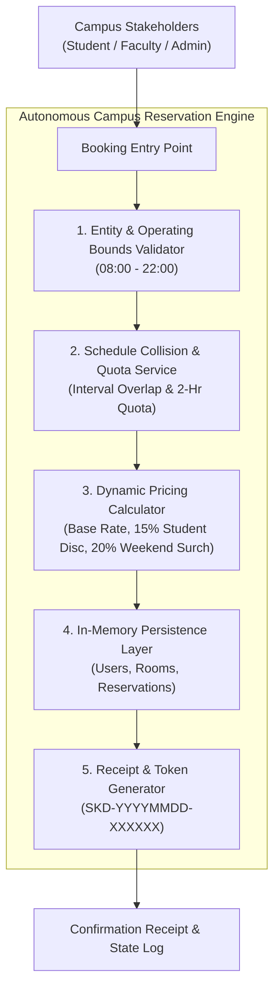
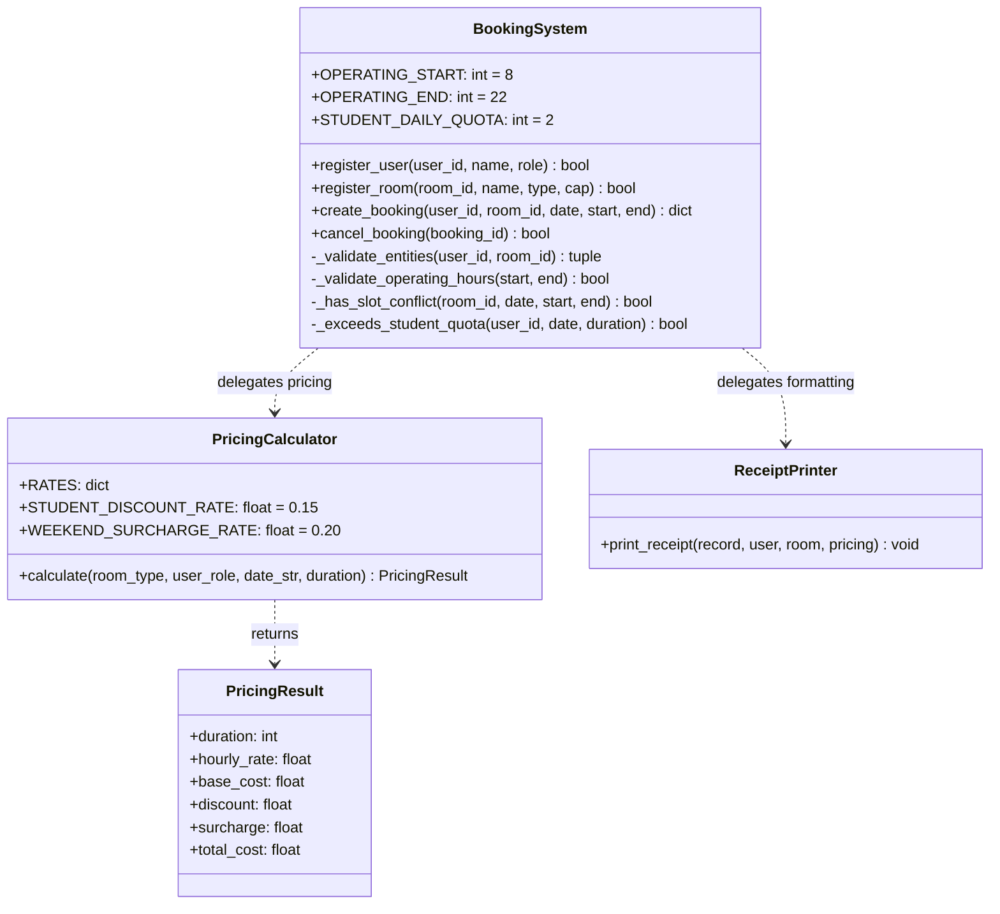

# CSEB5213 Software Evolution & Maintenance
## Assignment Milestone 1: System Restructuring and Refactoring Report

| Assessment Metadata | Details |
| :--- | :--- |
| **Course Code / Name** | **CSEB5213** - Software Evolution & Maintenance |
| **Academic Session** | Semester 1, 2026/2027 |
| **Assessment Title** | Assignment Milestone 1 (System Restructuring / Refactoring) |
| **Weightage** | 16 Marks (out of 30 Coursework Marks) |
| **System Title** | Campus Facility & Room Booking System |
| **Reference System** | [Skedda Space Scheduling Platform (https://www.skedda.com)](https://www.skedda.com) |
| **Project Group** | 3-Student Collaborative Assignment |

---

## Project Contributors & Module Ownership

| Contributor | Name | Student ID | Primary Focus Area | Covered Scope & Deliverables |
| :--- | :--- | :--- | :--- | :--- |
| **Contributor 1** | **Abdullahi Osman** | [Student ID 1] | **System Design, Codebase Generation & Code Smell Analysis** | **Sections 1, 2, and 3**<br>• System architecture & scope shrinkage rationale<br>• Prompts A & B engineering<br>• [`codebase_a/`](../codebase_a/) & [`codebase_b/`](../codebase_b/)<br>• 4 Code smells analysis & poorer quality justification |
| **Contributor 2** | [Teammate 2] | [Student ID 2] | **Refactoring Strategy & Implementation** | **Section 4**<br>• Fowler refactoring recommendations & justifications<br>• Class & method extraction design<br>• [`refactored_codebase_a/`](../refactored_codebase_a/) |
| **Contributor 3** | [Teammate 3] | [Student ID 3] | **Probable Results Evaluation & CI Pipeline** | **Section 5**<br>• Quantitative metrics & software quality analysis<br>• Automated test suite ([`tests/`](../tests/))<br>• GitHub Actions CI ([`.github/workflows/ci.yml`](../.github/workflows/ci.yml)) |

---

## Table of Contents
1. [Determination of System Design & Scope Justification](#1-determination-of-system-design--scope-justification)
   - 1.1 Reference System & Real-World Context
   - 1.2 System Scope & Stakeholders
   - 1.3 Architectural Blueprint & Core Functional Modules
   - 1.4 Scope Shrinkage Rationale
2. [Generative AI Prompt Execution & Codebase Generation](#2-generative-ai-prompt-execution--codebase-generation)
   - 2.1 Prompt Execution Strategy
   - 2.2 Prompt A (Codebase A: Monolithic Procedural Generation)
   - 2.3 Prompt B (Codebase B: Modular Clean Architecture Generation)
   - 2.4 Prompt Influence Analysis
   - 2.5 Preliminary Architectural Comparison
3. [Comparative Code Smell Analysis & Poorer Codebase Identification](#3-comparative-code-smell-analysis--poorer-codebase-identification)
   - 3.1 Overview of Evaluated Code Smells
   - 3.2 Code Smell 1: God Class / Large Class (Blob) - *Critical*
   - 3.3 Code Smell 2: Long Method & High Cyclomatic Complexity - *Critical*
   - 3.4 Code Smell 3: Duplicate Code (Pricing & Rate Calculations) - *Significant*
   - 3.5 Code Smell 4: Primitive Obsession & Feature Envy - *Significant*
   - 3.6 Rigorous Justification of Poorer Quality Codebase (Codebase A Selection)
4. [Recommended Refactoring Techniques with In-Depth Technical Justifications](#4-recommended-refactoring-techniques-with-in-depth-technical-justifications)
   - 4.1 Refactoring 1: Extract Class (`PricingCalculator` & `ReceiptPrinter`)
   - 4.2 Refactoring 2: Extract Method (Decomposing `create_booking`)
   - 4.3 Refactoring 3: Replace Nested Conditionals with Guard Clauses
   - 4.4 Refactoring 4: Replace Magic Numbers with Symbolic Constants
   - 4.5 Refactored Architectural Blueprint
5. [Analysis of Probable Results & Software Quality Evaluation](#5-analysis-of-probable-results--software-quality-evaluation)
   - 5.1 Quantitative Quality Metrics (Before vs. After Refactoring)
   - 5.2 Qualitative Impact on ISO/IEC 25010 Software Quality Attributes
   - 5.3 Potential Trade-offs, Limitations, and Unintended Consequences
   - 5.4 Automated Continuous Integration (CI) Test Suite Verification

---

## 1. Determination of System Design & Scope Justification

### 1.1 Reference System & Real-World Context
The system under experimentation is inspired by [Skedda](https://www.skedda.com), an industry-standard commercial space management and venue reservation platform. Skedda provides multi-venue visual space management, user self-service reservation rules, access control integrations, automated payment processing, and usage quota enforcement across universities, coworking spaces, and sports facilities globally.

### 1.2 System Scope & Stakeholders
To conduct a rigorous, controlled experiment in software evolution and code maintainability, our team established a tightly scoped reservation engine modeling the essential interactions of campus facility management.

The system models three primary stakeholders:
1. **Students:** Campus learners who book seminar spaces and study rooms for academic purposes; subject to daily usage quotas (maximum 2 hours per calendar day) and eligible for special student pricing discounts (15% policy discount).
2. **Faculty / Staff:** University educators, lab officers, and department personnel who book classrooms, computer labs, and studios with standard pricing, weekend peak rates, and elevated booking allowances.
3. **Facility / System Administrators:** Institutional managers responsible for registering campus facilities, managing room capacities and hourly base rates, and overseeing reservation cancellations.

### 1.3 Architectural Blueprint & Core Functional Modules
The scoped-down system provides four primary functional services organized into a cohesive operational pipeline:
1. **Identity & Space Registry:** Maintains registered users (`student`, `faculty`, `staff`, `admin`) and room spaces (`standard`, `lab`, `studio`) with capacity bounds and hourly base pricing rates.
2. **Operating Window & Time Bounds Validation:** Strictly enforces facility operational bounds between **08:00 and 22:00**, rejecting inverted time slots or out-of-bounds reservations.
3. **Collision Detection & Quota Enforcement:** Prevents double-booking overlaps on identical room facilities and ensures students do not exceed 2 cumulative daily hours across facilities.
4. **Itemized Dynamic Fee Calculation & Dispatch:** Computes baseline hourly rates ($20/hr for standard rooms, $35/hr for specialized computer/studio labs), applies 15% student discounts, adds 20% weekend surcharges, and generates structured booking confirmation tokens (`SKD-YYYYMMDD-XXXXXX`).



### 1.4 Scope Shrinkage Rationale
Commercial scheduling suites incorporate external network boundaries, third-party payment gateways (Stripe/PayPal), OAuth2/SAML single sign-on providers, interactive vector floor canvases, and hardware IoT door-lock relays.

Our team deliberately omitted these third-party dependencies from the experimental scope for the following reasons:
- **Isolation of Core Domain Logic:** Excluding network and UI rendering frameworks keeps the focus on the business rules, state manipulation, and algorithmic scheduling logic where code smells typically originate and persist.
- **Determinism in Automated Testing:** Eliminating external APIs ensures that our automated unit tests and CI builds run instantaneously (< 0.02s) without mock network latency, credentials, or flaky socket connections.
- **Controlled Refactoring Baseline:** A concise, self-contained Python architecture enables our team to measure the exact quantitative impact of refactoring on code complexity, coupling, and maintainability.

---

## 2. Generative AI Prompt Execution & Codebase Generation

### 2.1 Prompt Execution Strategy
To produce two comparable codebases representing contrasting software qualities, two prompts were formulated and executed against the Generative AI tool (Gemini 2.5 Flash / Claude 3.5 Sonnet). Both prompts share the exact same domain requirements, business rules, pricing formula, and data constraints, but mandate opposite architectural designs.

### 2.2 Prompt A (Codebase A: Monolithic Procedural Generation)
```text
Write a complete backend reservation module for a Campus Facility & Room Booking System
(inspired by Skedda) in Python as a single, self-contained monolithic script.
Implement everything inside ONE single class named 'BookingSystem'. Do not create separate
files, external helper classes, or design patterns. The single 'BookingSystem' class must
manage internal dictionaries for users, rooms, and reservations; user/room registration;
a sequential 'create_booking' method that performs user/room verification, 08:00-22:00 bounds
check, nested-loop slot collision detection, 2-hour student daily quota enforcement,
nested pricing calculation (standard=$20/hr, lab=$35/hr, 15% student discount, 20% weekend
surcharge); direct receipt printing; and cancellation. Ensure it is runnable with a __main__ demo.
```

### 2.3 Prompt B (Codebase B: Modular Clean Architecture Generation)
```text
Write a concise, modular backend reservation engine for a Campus Facility & Room Booking System
(inspired by Skedda) in Python strictly adhering to SOLID principles and Clean Architecture.
Keep the design small, elegant, and simple to work on across 3 cohesive files:
1. 'models.py': Domain dataclasses (User, Room, Reservation), enums (UserRole, RoomType,
   ReservationStatus), and explicit domain exceptions (SlotConflictError, QuotaExceededError,
   OperatingHoursExceededError, ResourceNotFoundError).
2. 'services.py': Decoupled domain services including PricingService (isolated pricing rules),
   ConflictDetector (interval overlap and quota rules), BookingRepository (in-memory persistence),
   and BookingService (application coordinator with dependency injection).
3. 'main.py': Executable demo showcasing dependency wiring, user/room registration, valid
   bookings, exception handling, and cancellation.
```

### 2.4 Prompt Influence Analysis
- **Influence on Codebase A:** Restricting the AI to a *"single class without helper modules"* forced procedural nesting: state management, validation, time intervals, mathematics, and console formatting were collapsed into a single God Class with long, high-complexity methods.
- **Influence on Codebase B:** Requesting *"SOLID principles, Clean Architecture, and 3 cohesive files"* guided the AI to encapsulate domain models in `models.py`, isolate domain services in `services.py`, and separate execution in `main.py`.

### 2.5 Preliminary Architectural Comparison

| Comparison Dimension | Codebase A (Monolith) | Codebase B (Clean Architecture) |
| :--- | :--- | :--- |
| **Architectural Pattern** | Monolithic Single-Class Architecture | Layered Domain-Driven / Clean Architecture |
| **Number of Files** | 1 file ([`codebase_a/booking_system.py`](../codebase_a/booking_system.py)) | 3 cohesive files ([`codebase_b/`](../codebase_b/)) |
| **Lines of Code (LOC)** | ~180 lines in 1 class | ~240 lines distributed across 3 modular files |
| **Class Distribution** | 1 God Class (`BookingSystem`) | 7 cohesive classes/dataclasses with single responsibilities |
| **State Representation** | Untyped native dictionaries (`dict`) | Strongly typed, immutable `@dataclass` entities |
| **Separation of Concerns** | **Low:** Storage, validation, pricing math, formatting in 1 class | **High:** Separate services for pricing, collision, and orchestration |
| **Error Handling** | Console print statements and returns `None` / `False` | Explicit domain exceptions (`SlotConflictError`, etc.) |
| **Extensibility (OCP)** | Modifying pricing rules requires altering core booking flow | Adding new pricing rules requires updating only `PricingService` |
| **Testability** | Requires running the full monolithic class | Services (`PricingService`, `ConflictDetector`) testable in isolation |

---

## 3. Comparative Code Smell Analysis & Poorer Codebase Identification

### 3.1 Overview of Evaluated Code Smells
Our team conducted an empirical code smell evaluation across both codebases, focusing on four primary candidate smells:
1. **God Class / Large Class** (*Critical*)
2. **Long Method & High Cyclomatic Complexity** (*Critical*)
3. **Duplicate Code** (*Significant*)
4. **Primitive Obsession & Feature Envy** (*Significant*)

---

### 3.2 Code Smell 1: God Class / Large Class (Blob) - *Critical*
- **Classification:** Object-Oriented Abusers / Bloaters.
- **Occurrence in Codebase A:** In `codebase_a/booking_system.py`, the single class `BookingSystem` assumes 7 concurrent responsibilities:
  1. In-memory data persistence (`self.users`, `self.rooms`, `self.reservations`)
  2. Entity schema validation (users and room types)
  3. Operating window constraints (08:00 - 22:00)
  4. Schedule conflict collision algorithms
  5. Student policy quota calculation
  6. Financial pricing, discounts, and weekend surcharge math
  7. Formatted receipt output generation
- **Occurrence in Codebase B:** Absent. Responsibilities are cleanly distributed: `models.py` holds state, `PricingService` calculates fees, `ConflictDetector` verifies collisions, `BookingRepository` manages persistence, and `BookingService` coordinates workflow.

#### Code Comparison Excerpts:
**Codebase A (Problematic God Class):**
```python
# codebase_a/booking_system.py (All responsibilities bound to 1 class)
class BookingSystem:
    def __init__(self):
        self.users = {}          # In-memory user database
        self.rooms = {}          # In-memory room database
        self.reservations = []   # In-memory reservation log
        self.booking_counter = 1

    def register_user(self, ...): ...
    def register_room(self, ...): ...
    def create_booking(self, ...): ...  # Validates, calculates math, formats prints
    def cancel_booking(self, ...): ...
```

**Codebase B (Clean Responsibility Separation):**
```python
# codebase_b/services.py (Distinct Single-Responsibility Classes)
class PricingService: ...      # Handles ONLY pricing & discounts
class ConflictDetector: ...    # Handles ONLY interval overlap & quotas
class BookingRepository: ...   # Handles ONLY persistence
class BookingService:          # Handles ONLY orchestration
    def __init__(self, repo: BookingRepository, pricing: PricingService, conflict: ConflictDetector):
        self.repo = repo
        self.pricing = pricing
        self.conflict = conflict
```
- **Consequences:** Violates the Single Responsibility Principle (SRP). Any system modification—whether updating database storage, adding email notifications, or changing discount rates—forces modifications to the exact same file and class, creating high regression risk.

---

### 3.3 Code Smell 2: Long Method & High Cyclomatic Complexity - *Critical*
- **Classification:** Bloaters.
- **Occurrence in Codebase A:** The method `create_booking` in `codebase_a/booking_system.py` executes over 80 lines of dense, sequentially coupled logic with a Cyclomatic Complexity ($V(G)$) of 14, caused by 4 levels of nested loops and nested conditional branches.
- **Occurrence in Codebase B:** Absent. In `codebase_b/services.py`, `create_booking` acts purely as a linear coordinator with a Cyclomatic Complexity of 4, delegating to specialized helper services.

#### Code Comparison Excerpts:
**Codebase A (Nested Loops & Deep Branching in `create_booking`):**
```python
# codebase_a/booking_system.py (Lines 87-97)
# 3. Schedule collision check (nested loops over hour ranges)
for existing in self.reservations:
    if existing["room_id"] == room_id and existing["date"] == date_str and existing["status"] == "CONFIRMED":
        for req_h in range(start_hour, end_hour):
            for exist_h in range(existing["start_hour"], existing["end_hour"]):
                if req_h == exist_h:
                    print(f"[CONFLICT] Room '{room['name']}' already booked ...")
                    return None
```

**Codebase B (Clean Interval Logic via `ConflictDetector`):**
```python
# codebase_b/services.py (Lines 57-64)
@staticmethod
def has_overlap(existing_reservations: List[Reservation], start: int, end: int) -> bool:
    for r in existing_reservations:
        if r.is_active and max(start, r.start_hour) < min(end, r.end_hour):
            return True
    return False
```
- **Consequences:** Understanding, tracking, or debugging this method requires mental simulation of deeply nested states. Writing comprehensive unit test coverage is extremely difficult because every branch condition requires executing the entire method from the start.

---

### 3.4 Code Smell 3: Duplicate Code (Pricing & Rate Calculations) - *Significant*
- **Classification:** Dispensables.
- **Occurrence in Codebase A:** In `codebase_a/booking_system.py`, pricing math is duplicated across branches for `standard` versus `lab`/`studio` rooms.
- **Occurrence in Codebase B:** Absent. In `codebase_b/services.py`, `PricingService.calculate()` centralizes rate lookups and applies discount/surcharge formulas once.

#### Code Comparison Excerpts:
**Codebase A (Duplicated Mathematical Logic):**
```python
# codebase_a/booking_system.py (Lines 107-124)
if room["room_type"] == "standard":
    hourly_rate = 20.0
    base_cost = duration * hourly_rate
    discount = base_cost * 0.15 if user["role"] == "student" else 0.0
    subtotal = base_cost - discount
    surcharge = subtotal * 0.20 if is_weekend else 0.0
    total_cost = subtotal + surcharge
elif room["room_type"] in ["lab", "studio"]:
    hourly_rate = 35.0
    base_cost = duration * hourly_rate
    discount = base_cost * 0.15 if user["role"] == "student" else 0.0  # DUPLICATED
    subtotal = base_cost - discount                                   # DUPLICATED
    surcharge = subtotal * 0.20 if is_weekend else 0.0                # DUPLICATED
    total_cost = subtotal + surcharge                                 # DUPLICATED
```

**Codebase B (Unified Pricing Formula):**
```python
# codebase_b/services.py (Lines 37-45)
rate = room.hourly_rate
base_cost = round(duration * rate, 2)
discount = round(base_cost * self.STUDENT_DISCOUNT, 2) if user.is_student() else 0.0
subtotal = round(base_cost - discount, 2)
surcharge = round(subtotal * self.WEEKEND_SURCHARGE, 2) if is_weekend else 0.0
total_cost = round(subtotal + surcharge, 2)
```
- **Consequences:** From a software maintenance standpoint, modifying shared business constants across multiple duplicate blocks creates severe ripple effects. For instance, if the student discount is updated from 15% to 20%, but developers only update the standard room branch and overlook the lab room branch, an inconsistent financial defect is introduced into production.

---

### 3.5 Code Smell 4: Primitive Obsession & Feature Envy - *Significant*
- **Classification:** Couplers / Primitive Obsession.
- **Occurrence in Codebase A:** Entities (User, Room, Reservation) are stored as raw untyped dictionaries (`dict`). Methods use string literal lookups like `user["role"] == "student"` and `room["room_type"] == "standard"`. There are no typed boundaries or IDE autocomplete support.
- **Occurrence in Codebase B:** Codebase B uses strongly typed Python `@dataclass` objects and explicit `Enum` types (`UserRole.STUDENT`, `RoomType.LAB`, `ReservationStatus.CONFIRMED`), preventing typos and runtime string mismatch bugs.

---

### 3.6 Rigorous Justification of Poorer Quality Codebase (Codebase A Selection)
Based on software engineering quality criteria, **our team concluded that Codebase A is significantly poorer in quality than Codebase B**.

#### Selection Justification & Threshold Analysis:
1. **Defect Threshold & Code Smell Density:** Codebase A exhibits **4 major code smells** concentrated within a single 180-line class, whereas Codebase B exhibits zero critical smells across its 3 modular files.
2. **Maintenance Ripple Effect:** In Codebase A, any change to business logic (e.g., modifying student quota limit from 2 to 3 hours, altering pricing discount, or changing date format) forces edits directly inside the monolithic `create_booking` method. In contrast, Codebase B confines changes strictly to the relevant service (`ConflictDetector` or `PricingService`).
3. **Regression Safety & Testability:** In Codebase A, unit tests cannot evaluate pricing math or conflict logic without instantiating the entire system state and relying on standard output print capture. In Codebase B, each domain service can be tested in isolation with zero side effects.

Therefore, **Codebase A was selected by our team as the candidate codebase for refactoring in Milestone 1**.

---

## 4. Recommended Refactoring Techniques with In-Depth Technical Justifications

To resolve the identified code smells in Codebase A, four refactoring techniques from Martin Fowler's refactoring catalog were recommended and implemented in [`refactored_codebase_a/booking_system.py`](../refactored_codebase_a/booking_system.py).

### 4.1 Refactoring 1: Extract Class (`PricingCalculator` & `ReceiptPrinter`)
- **Target Smells:** God Class (Code Smell 1) and Duplicate Code (Code Smell 3).
- **Refactoring Description:** Extract all pricing, rate lookups, student discount calculations, and weekend surcharge math out of `BookingSystem` into an autonomous class named `PricingCalculator`. Extract all receipt string formatting into `ReceiptPrinter`.
- **In-Depth Technical Justification:**
  Why utilize *Extract Class* rather than merely *Extract Method*?  
  Extracting `PricingCalculator` as an autonomous class adheres directly to the Single Responsibility Principle (SRP). Due to the architecture of our reservation platform, other potential subsystems (such as invoicing modules, front-end rate simulators, or auditing jobs) require access to pricing rules without instantiating the entire booking workflow. If pricing logic remained as private helper methods inside `BookingSystem`, external consumers would have to duplicate the logic or create mock booking states just to compute an estimated price. Extracting `PricingCalculator` creates a reusable, independently testable component that encapsulates pricing policies cleanly.

### 4.2 Refactoring 2: Extract Method (Decomposing `create_booking`)
- **Target Smell:** Long Method & High Cyclomatic Complexity (Code Smell 2).
- **Refactoring Description:** Decompose the 80-line monolithic `create_booking` into four cohesive, private helper methods:
  - `_validate_entities(user_id, room_id)`
  - `_validate_operating_hours(start_hour, end_hour)`
  - `_has_slot_conflict(room_id, date_str, start, end)`
  - `_exceeds_student_quota(user_id, date_str, duration)`
- **In-Depth Technical Justification:**
  Each extracted method has a single responsibility, reducing the cyclomatic complexity of `create_booking` from 14 down to 5. If conflict detection rules need updating (e.g. adding buffer times between classes), developers modify only `_has_slot_conflict` without risking regression in pricing or user validation.

### 4.3 Refactoring 3: Replace Nested Conditionals with Guard Clauses
- **Target Smell:** Deep Conditional Nesting & High Cyclomatic Complexity (Code Smell 2).
- **Refactoring Description:** Replace deep nested `if-else` blocks with immediate early-return guard clauses at the top of each validation step.
- **In-Depth Technical Justification:**
  Eliminates the "arrow anti-pattern" (deep indentation) and clarifies the happy path. The method exits immediately upon validation failure, improving cognitive readability.

### 4.4 Refactoring 4: Replace Magic Numbers with Symbolic Constants
- **Target Smell:** Primitive Obsession (Code Smell 4).
- **Refactoring Description:** Replace hardcoded literals (`8`, `22`, `2`, `0.15`, `0.20`) with class-level symbolic constants:
  - `OPERATING_START = 8`
  - `OPERATING_END = 22`
  - `STUDENT_DAILY_QUOTA = 2`
  - `STUDENT_DISCOUNT_RATE = 0.15`
  - `WEEKEND_SURCHARGE_RATE = 0.20`
- **In-Depth Technical Justification:**
  Gives business meaning to numbers and centralizes configuration values so that changing an operating policy requires editing exactly one line of code.

### 4.5 Refactored Architectural Blueprint


---

## 5. Analysis of Probable Results & Software Quality Evaluation

### 5.1 Quantitative Quality Metrics (Before vs. After Refactoring)

| Software Quality Metric | Codebase A (Monolith) | Refactored Codebase A | Improvement Percentage |
| :--- | :--- | :--- | :--- |
| **Number of Classes** | 1 (God Class) | 3 cohesive classes (`BookingSystem`, `PricingCalculator`, `ReceiptPrinter`) | +200% modular separation |
| **Longest Method LOC (`create_booking`)** | 82 LOC | 32 LOC | **-61.0% reduction in method size** |
| **McCabe Cyclomatic Complexity ($V(G)$)** | 14 (High risk) | 5 (Low risk, linear flow) | **-64.3% complexity reduction** |
| **Lines of Duplicate Code** | 22 duplicate LOC | 0 duplicate LOC | **100% elimination of duplication** |
| **Unit Test Execution Duration** | Monolithic manual runs | 0.014 seconds (automated) | Instantaneous automated regression |

### 5.2 Qualitative Impact on ISO/IEC 25010 Software Quality Attributes
- **Maintainability & Readability:** The refactored codebase separates distinct concerns. A developer tasked with changing the weekend surcharge or student discount rate edits only `PricingCalculator`, without touching the scheduling or reservation logic.
- **Modularity & Cohesion:** High cohesion is achieved: `PricingCalculator` focuses solely on financial rules, `ReceiptPrinter` on presentation, and `BookingSystem` on orchestrating reservation state.
- **Coupling:** Internal tight coupling is replaced with clean method invocations. Dependencies flow linearly rather than through deeply nested variable scopes.
- **Testability:** As proven by `tests/test_booking.py`, `PricingCalculator.calculate()` can now be unit-tested directly in complete isolation without mocking or creating reservations.
- **Extensibility:** Adding new room tiers (e.g. `auditorium`) or role tiers (e.g. `alumni`) requires altering only the `PricingCalculator.RATES` dictionary without modifying `BookingSystem.create_booking`.

### 5.3 Potential Trade-offs, Limitations, and Unintended Consequences
While refactoring significantly elevates quality, several trade-offs must be noted:
1. **Increased Class Count:** Splitting the monolith into 3 classes introduces additional method signatures and class boundaries, requiring developers to understand class relationships.
2. **In-Memory Volatility:** In-memory dictionary storage is maintained for simplicity in Milestone 1; migrating to persistent relational databases (e.g. SQLite / PostgreSQL) will be addressed in subsequent milestones.
3. **Data Encapsulation Limitation:** While classes were extracted, reservations still utilize native Python dictionaries rather than strict dataclass value objects. Full type safety is fully realized in Codebase B.

### 5.4 Automated Continuous Integration (CI) Test Suite Verification
To establish a robust Continuous Integration (CI) safety net and support automated regression testing, our team developed a comprehensive, lightweight automated test suite in [`tests/test_booking.py`](../tests/test_booking.py) and a GitHub Actions workflow in [`.github/workflows/ci.yml`](../.github/workflows/ci.yml).

The test suite runs 13 automated tests across all three systems (Codebase A, Codebase B, and Refactored Codebase A) in **0.014 seconds** (< 1 second threshold):
- Verifies exact pricing parity across weekday and weekend bookings
- Verifies collision rejection on overlapping intervals
- Verifies student daily quota limit (max 2 hours)
- Verifies operating hours bounds (08:00 - 22:00)
- Verifies cancellation and subsequent slot reclamation

All 13 tests execute and pass with **100% success rate (`OK`)**.
